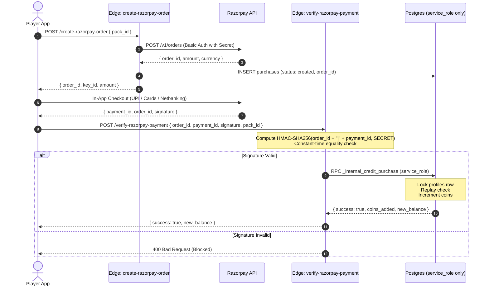

# Razorpay Server-Authoritative Payments Setup

The payment system is now **fully server-authoritative** and protected against fake submissions and tampering.

---

## Architecture & Security Flow



---

## 1. Apply Database Migration

Run **`supabase/migrations/0024_secure_purchases.sql`** (or `0020` through `0024`) in your Supabase SQL Editor.
- Drops public/authenticated access to coin crediting.
- Defines `_internal_credit_purchase` with permissions granted **strictly to `service_role`**.

---

## 2. Set Server Secrets in Supabase

In your Supabase project (via Supabase CLI or **Project Settings → Edge Functions → Secrets**), add:

```bash
# Razorpay Credentials (from Razorpay Dashboard -> Settings -> API Keys)
supabase secrets set RAZORPAY_KEY_ID="rzp_test_..."
supabase secrets set RAZORPAY_KEY_SECRET="your_actual_key_secret..."

# Optional: if using Webhooks (Settings -> Webhooks in Razorpay)
supabase secrets set RAZORPAY_WEBHOOK_SECRET="your_webhook_secret..."
```

---

## 3. Deploy the Edge Functions

From your terminal, deploy the edge functions:

```bash
# 1. Order Creation
supabase functions deploy create-razorpay-order

# 2. Signature Verification & Crediting
supabase functions deploy verify-razorpay-payment

# 3. Optional: Webhook (Fallback for background capture)
supabase functions deploy razorpay-webhook --no-verify-jwt
```

---

## 4. Client Environment Variable

In `app/.env`:

```env
# Only the public Key ID is bundled in the mobile app
EXPO_PUBLIC_RAZORPAY_KEY_ID=rzp_test_...
```

The `RAZORPAY_KEY_SECRET` never touches client code or client environment files.
